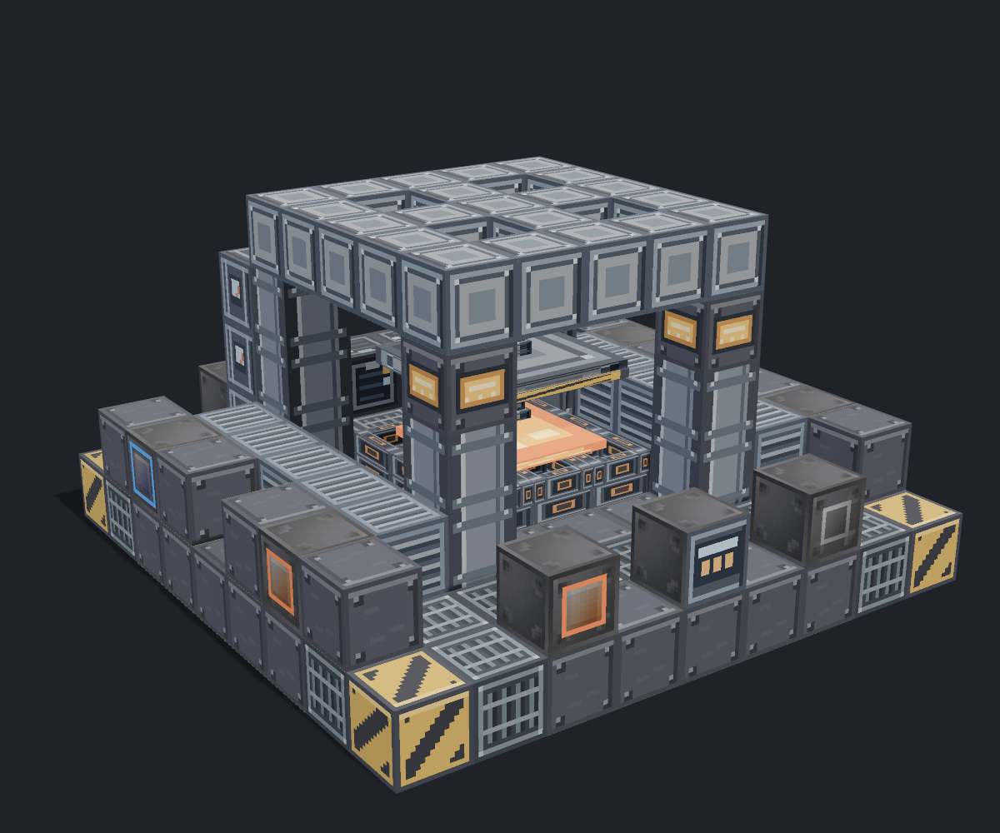
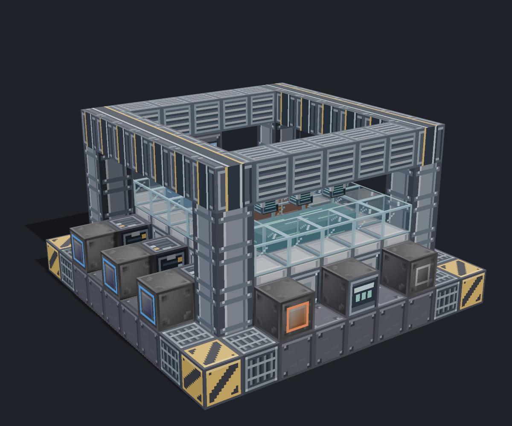
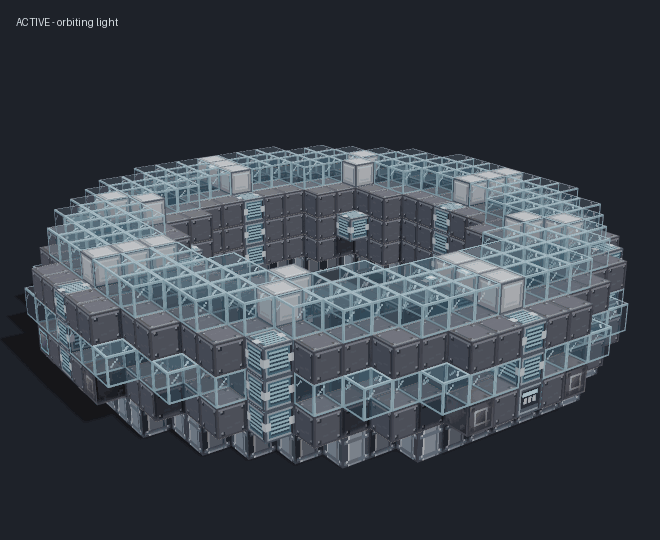
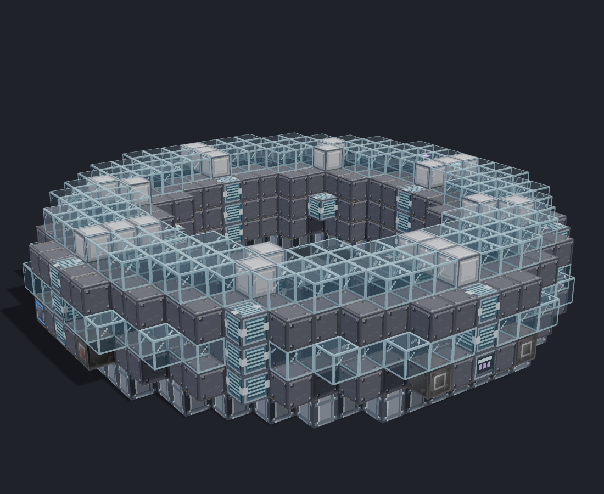
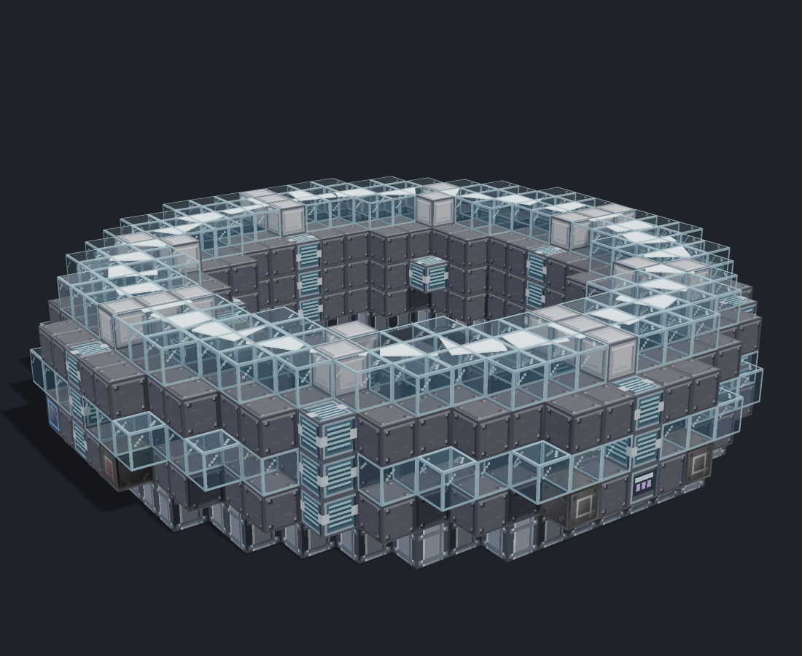

# Nexus production machines

Three editable Blockbench assemblies, each built from individually placed blocks. These are **models, animation studies and construction blueprints**. The individual blocks and native MI controllers/hatches are now installed in RevoIndustry, with executable structure definitions and EMI assembly guides. Survival crafting and the proposed material-processing ledger remain pending in `missingrecipies.md`. The press/rack clips are animation studies; the collider has runtime orbiting-light and completion-flash effects.

Dimensions below are width x depth x height.

| Machine | Dimensions | Structural blocks | Hatches/controller | Clip |
|---|---|---:|---:|---|
| [Pressure Casting Plant](pressure_casting_plant.bbmodel) | **9 x 9 x 5** | 161 | 9 | `pressure_casting_cycle`, eight seconds |
| [Electroplating Line](electroplating_line.bbmodel) | **9 x 9 x 5** | 199 | 10 | `three_bath_plating_cycle`, eighteen seconds |
| [Particle Collider](particle_collider.bbmodel) | **21 x 21 x 5** | 784 | 9 | `opposed_beam_cycle`, twelve seconds; `completion_flash`, 1.2 seconds, once |






## Design

- **Caster:** reinforced four-column frame, hydraulic drive, recessed mould table, pressure tanks, cooling manifolds and a moving platen. The surrounding blocks stay static; only the contained mechanism performs the press cycle.
- **Plating:** three distinct baths under an overhead gantry. Viewing windows expose the fluids. The rack rises above the dividers before travelling and the hoist extends as it descends into each bath.
- **Collider:** a hollow toroidal accelerator, replacing the earlier cone proposal. Its centre stays open through all five layers. Opposed injector housings, magnet bands and inspection windows surround a reserved beam tunnel. White-hot cyan/violet lights orbit inside that tunnel with diminishing trails. Inspection-glass fluorescence makes their motion visible from above. A separate, single completion flash lights 32 lenses around the entire ring, peaks at 0.10-0.18 seconds and fades out by 0.75 seconds.
- All ports face outward and use the native MI-style casing/overlay artwork inherited from the approved portal. Dedicated hatch roles are recorded in each blueprint. Runtime must reuse MI's actual configurable inventories, fluid and energy behavior rather than treating the art as implementation.

## Files

- Three root `.bbmodel` files: editable Generic assembly previews; never export them as a giant formed-machine model.
- `parts/`: 27 editable Java Block/Item sources, including the shaped mould bed, hydraulic cylinder and bath window block.
- `java-models/`: corresponding individual 1.21.1-compatible exports, using `revoindustry:block/nexus_machine_atlas`.
- `textures/`: native pixel-art atlas and a separate emissive-material copy used only by contained hot-metal/beam visuals.
- `blueprints/`: exact block coordinates, dimensions, counts, reserved air, outward-facing hatches and hatch roles.
- `machine-index.json`: model/part inventory.
- `asset-validation.json`: dimension, connectivity, symmetry, hatch, air, clearance, shape and loop checks.
- `mcp-validation.json`: Blockbench geometry/animation checks and per-part bounds verification. Name-based mirror/detachment gates that do not apply are explicitly recorded as skipped; independent blueprint checks cover structural symmetry and the moving-part clearances.

The recipe/material plan is in [NEXUS-ENDGAME.md](../../../docs/NEXUS-ENDGAME.md).

## Collider activation and completion



Preview `opposed_beam_cycle` while processing: one full orbit takes twelve seconds and the completion lenses stay hidden. On a **successful recipe completion**, stop that clip and play `completion_flash` **once**. When idle or when power is lost, stop both clips and have the renderer hide the beam and completion-flash groups explicitly: the unanimated editing pose exposes the lenses for authoring. Pausing, cancellation, an invalid structure or a full output must not trigger the completion flash. The physical blocks remain static in both clips.

These are emissive model visuals. Blockbench does not simulate light spilling onto surrounding blocks. The eventual Java client renderer must drive the clips from synchronized machine state and provide the requested short-lived illumination across the structure. Keep that illumination client-side and localized; do not repeatedly replace world blocks or recalculate chunk lighting for the moving light. No dynamic-light mod is required by these art assets, and live game lighting is not implemented by this model pass.





## Reproduction

```powershell
.local/venv/Scripts/python.exe scripts/prepare_nexus_machine_assets.py
```

This writes the texture/blueprint inputs here and native Blockbench MCP edit operations under `.local/nexus-machines`. Author the three assemblies with Generic format and the individual parts with Java Block/Item format. Embed `nexus_machine_atlas.png`; the caster/collider also use `nexus_machine_effects.png` as an emissive texture. Export only the individual block models for Java 1.21.1.

If MCP exports into another configured workspace, collect the authored results with:

```powershell
.local/venv/Scripts/python.exe scripts/finalize_nexus_machine_assets.py --source "C:\path\to\MCP\nexus-machines"
```

The collector copies exports into this project, makes texture references local, assigns future runtime namespaces and runs the asset checks. Save active Blockbench work before collecting a new revision.
