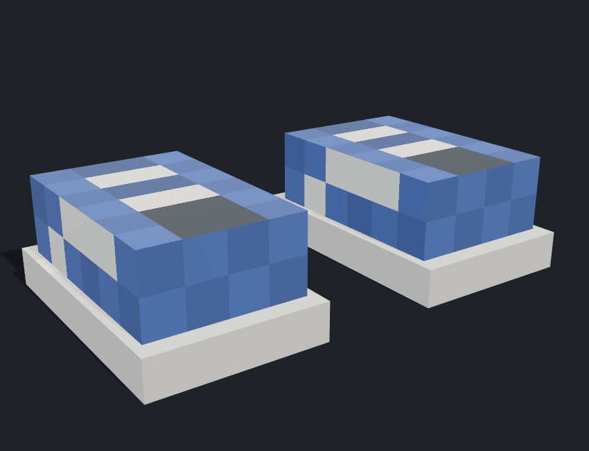
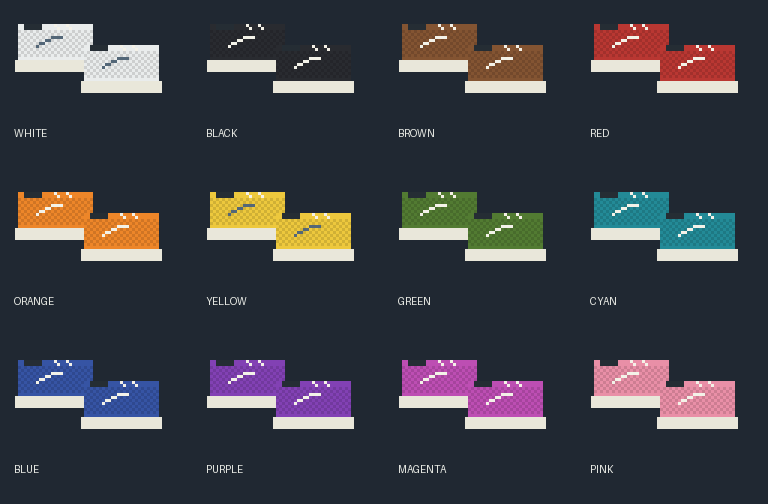

# Running shoes — Blockbench MCP sources

Simplified to two cuboids per shoe: one solid upper and one sole. Laces and the
ankle opening are painted details. Both item and wearable models use this shape.
The upper has restrained two-tone pixel dithering and centered top laces.

- `*_running_shoes.bbmodel`: twelve editable item models, with embedded textures.
- `running_shoes_worn.bbmodel`: shared leg-bound wearable geometry, using blue as
  its preview palette; runtime armor materials choose each pair's matching texture.
- `RunningShoesNative.java`: unmodified native Blockbench MCP Java exporter output.
- `textures/`: twelve authored native pixel atlases.
- `mcp-validation.json`: MCP checks of all thirteen model sources.
- `export-validation.json`: runtime item export hashes and cube counts.
- `references/`: user-supplied visual reference.

The sources and all runtime shoe geometry are edited/exported through Blockbench
MCP. If MCP is unavailable, stop and ask the user. Do not regenerate geometry by
writing JSON or Java cubes directly. The Java collector only extracts the native
exported layer method and adds the project package/import adapter.

See [recipes and gameplay](../../../docs/RUNNING-SHOES.md).
