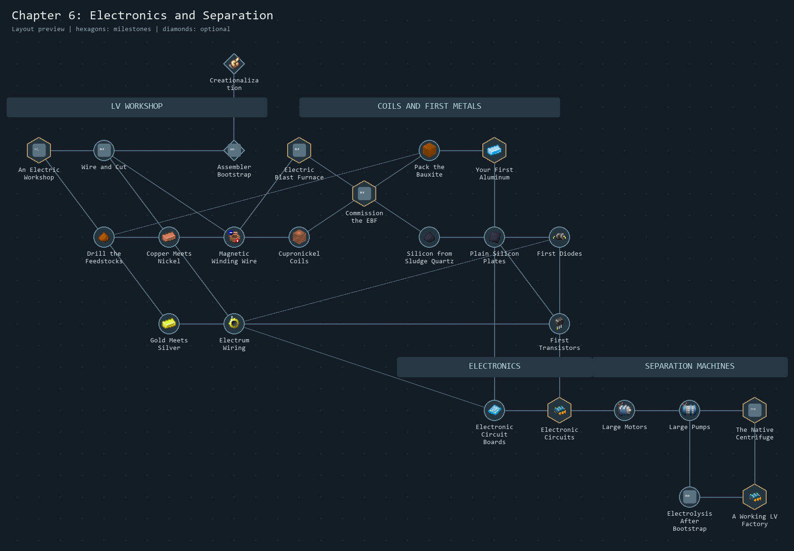
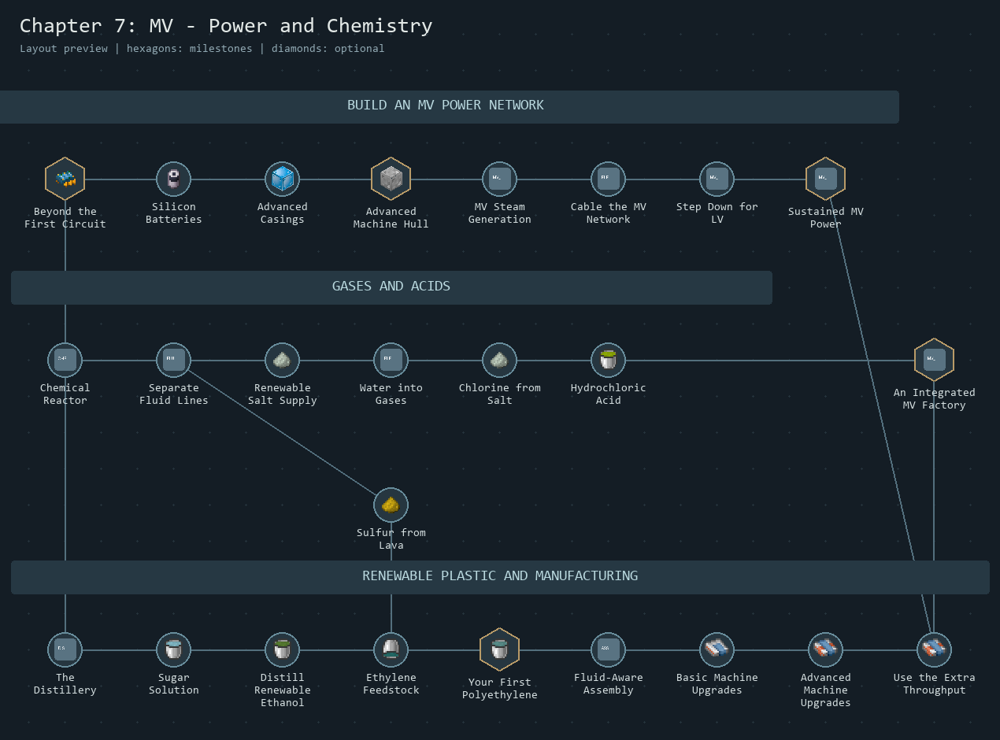
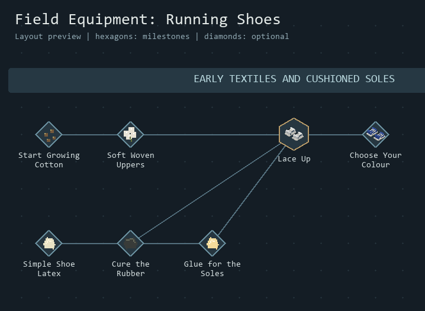

# Quest continuation: LV, MV and running shoes

The LV/MV pass expanded the book from 145 quests in eight chapters to 202 in eleven.
The subsequent [HV continuation](PROGRESSION-GAPS-AFTER-MV.md) brings it to 287 quests
in fourteen chapters.
This adds guidance for installed production routes; it does not add new machines
or change recipes, mineral sources, energy requirements or resource yields.

| New chapter | Quests | Route |
|---|---:|---|
| Chapter 6: Electronics and Separation | 25 | First electric workshop -> drilled feedstocks -> cupronickel coils and EBF -> aluminum/silicon -> electrum -> electronic components -> Large Motors/Pumps -> Centrifuge/Electrolyzer. Includes an early optional Assembler/Creationalization branch. |
| Chapter 7: MV - Power and Chemistry | 25 | Silicon batteries and hulls -> MV turbine/cables -> transformer and sustained power; parallel native chemistry -> salt/gases/acids -> renewable ethanol/ethylene/polyethylene -> Advanced Upgrades and integrated production. |
| Field Equipment: Running Shoes | 7 | Cotton seeds and harvest, shoe latex/rubber, glue, white shoes and twelve-colour guidance. Entire branch is optional. |







## Bootstrap and progression rules

- The first EBF controller uses its existing crafting-table recipe. An Assembler
  is not required to manufacture its own first controller or the first EBF.
- First aluminum uses nine drilled Bauxite Dust packed into a Bauxite Block,
  then the 32 EU/t EBF recipe. The Electrolyzer follows aluminum and electronics.
- Silicon comes from sludge-derived Quartz, maceration and the native coke/EBF
  route. Plain silicon plates work in the first Diode and Transistor recipes.
- The existing salt quest now depends on the Chapter 5 Centrifuge milestone.
  Building the geode earlier remains possible; salt water can wait in storage.
- Minerals still originate in drills. Gems still originate in sludge processing.
  Native quarries remain excluded. No rewards create feedstocks or unlock items.
- First renewable plastic uses the native lead route. Chromium is a later
  efficiency alternative, not a bootstrap prerequisite. The text explicitly
  covers sulfuric-acid byproduct routing and the low-yield starter ethanol recipe.
- MV power and chemistry are parallel branches, joining at a practical factory
  milestone. The quest book does not pretend that chemistry recipes themselves
  all require MV power; many native recipes run at lower EU/t.
- The two same-cost Creationalization recipes are taught as optional later
  automation for existing Create components. Native ingredient gates remain.
- Shoes stay early, require their actual ingredients and grant no industrial
  rubber shortcut. The colour lesson describes crafting fresh coloured pairs,
  not a nonexistent recolouring recipe.

## Save compatibility and detection

All 204 published remote quest IDs and their task/reward IDs are preserved. Only the existing
salt quest's explanation and prerequisites change. New chapter bases are
`5EC0000000000000`, `5ED0000000000000` and `5EA0000000000000`; their explicit
quest numbers must never be shifted when adding future nodes. No saved player
completion data is edited.

Item tasks detect possession and consume nothing. Checkmark quests ask the player
to confirm actual production or commissioning. They do not automatically verify
machine placement, powered work, fluids in tanks or sustained generation. This
limitation is explained in the opening LV quest and each commissioning lesson.

The existing free-manual protection, tips and cosmetic rewards are retained.
No material, XP or item rewards were added by these chapters.

## Verification and regeneration

```powershell
.local/venv/Scripts/python.exe scripts/extend_quest_book.py --render
.local/venv/Scripts/python.exe scripts/verify_quest_book.py
.\dev.cmd assemble collectMods :revolib:syncPackOverrides
```

Run the continuation generator **last** after older progression generators. It
is deterministic and repeatable. `verify_quest_book.py` checks all chapter IDs,
quest/task/reward/banner IDs, dependencies and cycles, new node spacing, native
item/model references, non-consuming tasks, stable existing IDs and key bootstrap
ordering. Recipe numbers were checked against the pinned MI 2.5.11 JAR; selected
source recipes are preserved in [the evidence file](../art/quests/lv-mv/recipe-evidence.json).

Offline maps use the real quest positions and item IDs. Some native dynamic
machine icons fall back to labels in this offline renderer; the in-game book
uses MI's real item renderer. The maps are not Minecraft screenshots. No live
client inspection or complete fresh-island LV-to-MV playthrough is claimed.

Further quest work: later power, explicitly gated AE2 presses/Sky Stone and
endgame production. Advanced metallurgy/coils, freezing and first HV are now
taught by Chapter 8. The Nexus portal and its three
machines remain art/design assets and are not presented as playable quests.

## Pulled work retained

The repository merge preserves Chapter 5: The LV Factory (48 quests, `5E800000`) and Crystals and Distant Resources (10 quests, `5E900000`). The local electronics extension is Chapter 6 (`5EC00000`), followed by Chapter 7 MV (`5ED00000`) and Chapter 8 HV (`5EB00000`). The electronics extension starts after the original LV first-aluminum handoff; its first metallurgy lessons review that established workshop. All published remote IDs remain unchanged. AE2 starter recipes/MV gates and later resource routes now exist; see the updated gap table.
